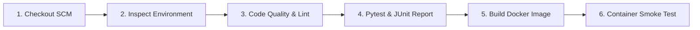

# Ganesh DevOps Project 2 ⚡

A high-performance Full-Stack Web Application built with **FastAPI**, featuring interactive OpenAPI/Swagger documentation, modern responsive UI dashboard, containerized with **Docker**, and automated end-to-end with **Jenkins CI/CD** and **GitHub Actions**.


---

## 🌟 Architecture & Features

- **Asynchronous ASGI Backend**: Built with FastAPI and Uvicorn for asynchronous I/O and low-latency API responses.
- **Auto-Generated API Documentation**: Native interactive Swagger UI at `/docs` and ReDoc at `/redoc`.
- **Responsive Web Dashboard**: Dark-mode frontend with live system metrics, active container indicators, and dynamic AJAX-powered task management.
- **RESTful CRUD Operations**: Full API endpoints (`/api/items`) for managing DevOps milestones with Pydantic v2 data validation.
- **Production Docker Image**: Multi-stage `Dockerfile` running as non-privileged `appuser` with container-level `HEALTHCHECK`.
- **Jenkins Declarative Pipeline**: Automated 6-stage cross-platform pipeline (Windows & Linux compatible) with JUnit test reporting and container smoke testing.
- **GitHub Actions CI/CD**: Cloud pipeline in `.github/workflows/ci.yml` providing automated test gates on every push and pull request.

---

## 📁 Project Directory Structure

```
C:\ganesh_devops_project_2\
│
├── app/
│   ├── __init__.py           # Application package initializer
│   ├── main.py               # FastAPI backend with REST routes & template handlers
│   ├── static/
│   │   ├── style.css         # Modern glassmorphism UI stylesheet
│   │   └── app.js            # Frontend JavaScript for AJAX API operations
│   └── templates/
│       └── index.html        # Interactive DevOps control dashboard
│
├── tests/
│   ├── __init__.py           # Test package initializer
│   └── test_main.py          # Pytest suite (9 tests covering health, metrics, CRUD, and errors)
│
├── .github/
│   └── workflows/
│       └── ci.yml            # GitHub Actions CI workflow
│
├── Dockerfile                # Production non-root Docker build specification
├── .dockerignore             # Docker build context exclusions
├── docker-compose.yml        # Docker Compose service definition
├── Jenkinsfile               # Declarative Jenkins CI/CD pipeline
├── requirements.txt          # Python dependencies (FastAPI, Uvicorn, Pydantic, Pytest)
├── .gitignore                # Git ignore patterns
└── README.md                 # Complete project documentation
```

---

## 🚦 Quick Start Guide

### 1. Run Locally with Python

```powershell
# Navigate into the project directory
cd C:\ganesh_devops_project_2

# Install dependencies
pip install -r requirements.txt

# Run the automated test suite
pytest -v tests/

# Start the application server
uvicorn app.main:app --host 0.0.0.0 --port 8000 --reload
```

- Web Dashboard: [http://localhost:8000](http://localhost:8000)
- Interactive Swagger UI: [http://localhost:8000/docs](http://localhost:8000/docs)
- Interactive ReDoc: [http://localhost:8000/redoc](http://localhost:8000/redoc)

---

### 2. Run with Docker

```powershell
# Build the Docker image
docker build -t ganesh-devops-project-2:latest .

# Run the containerized service
docker run -d --name ganesh-fastapi-app -p 8000:8000 ganesh-devops-project-2:latest

# Verify health status
curl http://localhost:8000/health

# Stop and remove the container
docker stop ganesh-fastapi-app && docker rm ganesh-fastapi-app
```

---

### 3. Run with Docker Compose

```powershell
# Start the service in the background
docker compose up -d

# Check service status and health
docker compose ps

# View live application logs
docker compose logs -f

# Shut down the stack
docker compose down
```

---

## ⚙️ Jenkins CI/CD Pipeline

The `Jenkinsfile` runs an automated 6-stage lifecycle:



### Setting up the Jenkins Pipeline Job:
1. Open Jenkins at `http://localhost:8080`.
2. Click **New Item** ➔ Name it `ganesh-devops-project-2-pipeline` ➔ Select **Pipeline** ➔ Click **OK**.
3. Under the **Pipeline** configuration:
   - **Definition**: *Pipeline script from SCM*
   - **SCM**: *Git*
   - **Repository URL**: `https://github.com/Tharun830/ganesh_devops_project_2.git`
   - **Branch Specifier**: `*/main`
   - **Script Path**: `Jenkinsfile`
4. Click **Save** ➔ **Build Now**.

---

## 🌐 REST API Endpoints

| Method | Endpoint | Description | Response |
| :--- | :--- | :--- | :--- |
| `GET` | `/` | Full-stack interactive web dashboard | HTML Page |
| `GET` | `/health` | Container & pipeline health status | `{"status": "UP", "framework": "FastAPI"}` |
| `GET` | `/api/metrics` | System uptime, OS, and active item counts | `{"status": "healthy", "system_metrics": {...}}` |
| `GET` | `/api/items` | List all DevOps milestone items | `[{"id": 1, "title": "...", ...}]` |
| `GET` | `/api/items/{id}` | Retrieve details for a specific item | Single item object |
| `POST` | `/api/items` | Add a new milestone with Pydantic validation | Created item with `201 Created` |
| `PUT` | `/api/items/{id}` | Update title, category, priority, or status | Updated item object |
| `DELETE`| `/api/items/{id}` | Remove an item by ID | `204 No Content` |
| `GET` | `/docs` | Interactive Swagger OpenAPI Explorer | Interactive UI |
| `GET` | `/redoc` | Interactive ReDoc Technical Documentation | API Documentation |

---

## 📄 License
This project is open-source under the MIT License.
